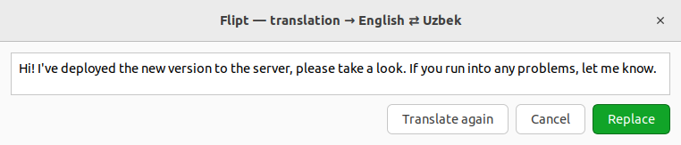
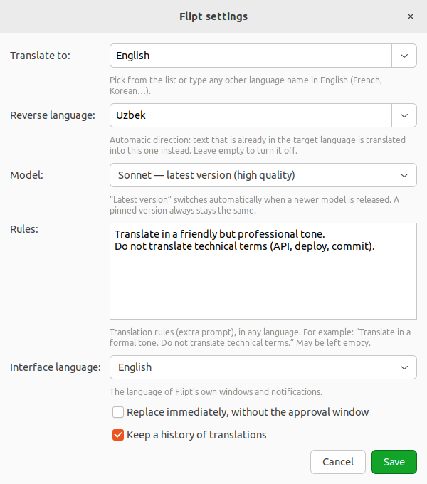

<p align="center"></p>

# Flipt

[English](#english) · [Русский](#русский) · [O'zbekcha](#ozbekcha)

<p align="center"></p>

---

## English

A small Linux app that translates the selected text with the [Claude Code](https://claude.com/claude-code) CLI
and, once you approve the result, puts it in place of the original.
(Flipt = flip + text: one key flips your text into another language.)

1. Select text in any application.
2. Press `Super+T`.
3. A window opens at once and the translation appears in it as it is written — edit it if needed,
   or click **Translate again** for another wording.
4. Click **Replace** and the selected text is replaced with the translation.

Also:

- **Automatic direction** — with a reverse language set, text that is already in the target language is
  translated back (for example Uzbek → Russian and Russian → Uzbek with the same key).
- **Replace immediately** — an option to skip the approval window.
- **History** — the latest translations are in the top-bar icon menu; clicking one copies it.
- **Terminals** — in a terminal the translation is pasted with `Ctrl+Shift+V`.
- The interface is available in English (default), Uzbek and Russian.

### Requirements

- Ubuntu with GNOME, Wayland or X11 session. Tested on Ubuntu 22.04 with Wayland;
  **the X11 code path has not been tested yet**.
- [Claude Code CLI](https://claude.com/claude-code) installed and signed in (the `claude` command must work)
- Wayland: `wl-clipboard`, `ydotool`; X11: `xclip`, `xdotool`; both: `python3-gi` — the installer sets these up

### Installation

```bash
git clone git@github.com:firefoxuz/flipt.git
cd flipt
./install.sh
```

The installer:

- copies the script to `~/.local/bin/flipt`;
- adds a **Flipt** entry to the applications menu and installs its icons (`assets/`);
- on Wayland, grants access to `/dev/uinput` so that `ydotool` works (asks for `sudo`);
- registers the `Super+T` hotkey. For a different key: `FLIPT_HOTKEY='<Super>y' ./install.sh`
- pins a **Flipt icon to the top bar** and starts it at every login. Its menu translates the selected text,
  switches the target language, shows the history and opens the settings.

> Access to `/dev/uinput` lets any program running under your user simulate key presses.
> Intended for a personal computer.

To remove Flipt: `./uninstall.sh` (keeps the settings and the history) or `./uninstall.sh --purge`.

### Settings

Open **Flipt** from the applications menu, or run `flipt --settings`:

<p align="center"></p>

- **Translate to** — pick from the list or type one (English name: `French`, `Korean`…)
- **Reverse language** — turns on the automatic direction: text already in the target language is translated
  into this one. Leave empty to turn it off.
- **Model** — Haiku / Sonnet / Opus / Fable, latest or a pinned version
- **Rules** — an extra prompt for the translation, for example:
  "Translate in a formal tone. Do not translate technical terms."
- **Interface language** — the language of Flipt's own windows and notifications: English, O'zbekcha, Русский
- **Replace immediately, without the approval window** — the translation is pasted as soon as it is ready
- **Keep a history of translations** — the last 30, stored in `~/.local/share/flipt/history.jsonl`

Everything is stored in `~/.config/flipt/config.conf`, which you can also edit by hand:

```
LANG=Russian
LANG2=Uzbek
MODEL=sonnet
UI_LANG=en
AUTO_REPLACE=no
HISTORY=yes

[PROMPT]
Translate in a formal tone.
Do not translate technical terms (API, deploy, commit).
```

### Commands

| Command | What it does |
|---|---|
| `flipt` | translates the selected text into the configured language (this is what the hotkey runs) |
| `flipt Russian` | one-off translation into another language |
| `flipt --settings` | settings window |
| `flipt --tray` / `flipt --tray-stop` | show / remove the top-bar icon |
| `flipt --about` | "About" window (also in the icon menu and the app's right-click menu) |
| `flipt --clear-history` | deletes the translation history |
| `flipt --show` | current settings |
| `echo "text" \| flipt --stdin` | no window, the result is printed to the terminal |

### Limitations

- Each translation starts `claude` from scratch: the first words take about 2 seconds to appear, whatever the text length.
- On Wayland a terminal is recognised through the accessibility bus. That covers GNOME Terminal and other
  GTK terminals; kitty, alacritty and foot are not recognised there, so the translation stays in the clipboard.
- In a terminal the selected text is not replaced (a terminal cannot do that): the translation is inserted at the cursor.
- The history is a plain text file readable only by you. Turn it off in the settings if you translate sensitive text.

### License

[MIT](LICENSE)

---

## Русский

Небольшое приложение для Linux: переводит выделенный текст через CLI [Claude Code](https://claude.com/claude-code)
и после вашего подтверждения вставляет перевод на место оригинала.
(Flipt = flip + text: одна клавиша «переворачивает» текст на другой язык.)

1. Выделите текст в любом приложении.
2. Нажмите `Super+T`.
3. Окно открывается сразу, и перевод появляется в нём по мере написания — при необходимости отредактируйте его
   или нажмите **Перевести заново** (**Translate again**), чтобы получить другой вариант.
4. Нажмите **Заменить** (**Replace**), и выделенный текст заменится переводом.

А также:

- **Автоматическое направление** — если задан обратный язык, текст, который уже на языке перевода,
  переводится обратно (например, узбекский → русский и русский → узбекский одной клавишей).
- **Замена сразу** — настройка, отключающая окно подтверждения.
- **История** — последние переводы в меню значка в верхней панели; щелчок копирует перевод.
- **Терминалы** — в терминале перевод вставляется через `Ctrl+Shift+V`.
- Интерфейс доступен на английском (по умолчанию), узбекском и русском.

### Требования

- Ubuntu с GNOME, сессия Wayland или X11. Проверено на Ubuntu 22.04 с Wayland;
  **работа в X11 пока не проверялась**.
- Установленный [Claude Code CLI](https://claude.com/claude-code) с выполненным входом (команда `claude` должна работать)
- Wayland: `wl-clipboard`, `ydotool`; X11: `xclip`, `xdotool`; везде: `python3-gi` — установщик поставит их сам

### Установка

```bash
git clone git@github.com:firefoxuz/flipt.git
cd flipt
./install.sh
```

Установщик:

- копирует скрипт в `~/.local/bin/flipt`;
- добавляет ярлык **Flipt** в меню приложений и устанавливает значки (`assets/`);
- в Wayland выдаёт доступ к `/dev/uinput`, чтобы работал `ydotool` (запросит `sudo`);
- регистрирует горячую клавишу `Super+T`. Для другой клавиши: `FLIPT_HOTKEY='<Super>y' ./install.sh`
- закрепляет **значок Flipt в верхней панели** и запускает его при каждом входе в систему. Через его меню можно
  перевести выделенный текст, сменить язык перевода, посмотреть историю и открыть настройки.

> Доступ к `/dev/uinput` позволяет любой программе, запущенной от вашего имени, имитировать
> нажатия клавиш. Рассчитано на личный компьютер.

Удаление: `./uninstall.sh` (настройки и история сохраняются) или `./uninstall.sh --purge`.

### Настройки

Откройте **Flipt** в меню приложений или выполните `flipt --settings`:

- **Язык перевода** — выберите из списка или введите вручную (название по-английски: `French`, `Korean`…)
- **Обратный язык** — включает автоматическое направление: текст, который уже на языке перевода,
  переводится на этот язык. Оставьте пустым, чтобы отключить.
- **Модель** — Haiku / Sonnet / Opus / Fable, последняя или конкретная версия
- **Правила** — дополнительный промпт для перевода, например:
  «Переводи в официальном стиле. Технические термины не переводи.»
- **Язык интерфейса** — язык окон и уведомлений самого Flipt: English, O'zbekcha, Русский.
  По умолчанию английский; чтобы переключить, выберите **Русский** в поле **Interface language**.
- **Заменять сразу, без окна подтверждения** — перевод вставляется, как только он готов
- **Хранить историю переводов** — последние 30, в файле `~/.local/share/flipt/history.jsonl`

Всё хранится в файле `~/.config/flipt/config.conf`, его можно править и вручную:

```
LANG=Russian
LANG2=Uzbek
MODEL=sonnet
UI_LANG=ru
AUTO_REPLACE=no
HISTORY=yes

[PROMPT]
Переводи в официальном стиле.
Технические термины (API, deploy, commit) не переводи.
```

### Команды

| Команда | Что делает |
|---|---|
| `flipt` | переводит выделенный текст на язык из настроек (её вызывает горячая клавиша) |
| `flipt Russian` | разовый перевод на другой язык |
| `flipt --settings` | окно настроек |
| `flipt --tray` / `flipt --tray-stop` | показать / убрать значок в верхней панели |
| `flipt --about` | окно «О программе» (также в меню значка и в контекстном меню приложения) |
| `flipt --clear-history` | удаляет историю переводов |
| `flipt --show` | текущие настройки |
| `echo "текст" \| flipt --stdin` | без окна, результат выводится в терминал |

### Ограничения

- Каждый перевод запускает `claude` заново: первые слова появляются примерно через 2 секунды при любой длине текста.
- В Wayland терминал определяется через шину специальных возможностей. Это работает для GNOME Terminal и других
  терминалов на GTK; kitty, alacritty и foot так не определяются, и перевод остаётся в буфере обмена.
- В терминале выделенный текст не заменяется (терминал этого не умеет): перевод вставляется в позицию курсора.
- История — обычный текстовый файл, доступный только вам. Отключите её в настройках, если переводите конфиденциальные тексты.

### Лицензия

[MIT](LICENSE)

---

## O'zbekcha

Belgilangan matnni [Claude Code](https://claude.com/claude-code) CLI orqali tarjima qilib,
tasdiqlaganingizdan keyin o'rniga qo'yadigan kichik Linux ilovasi.
(Flipt = flip + text: bitta tugma matnni boshqa tilga «ag'daradi».)

1. Istalgan ilovada matnni belgilaysiz.
2. `Super+T` bosasiz.
3. Oyna darhol ochiladi va tarjima yozilishi bilan unda paydo bo'ladi — kerak bo'lsa tahrirlaysiz
   yoki boshqa variant uchun **Qayta tarjima** (**Translate again**) bosasiz.
4. **Almashtirish** (**Replace**) bossangiz, belgilangan matn tarjimaga almashadi.

Yana:

- **Avtomatik yo'nalish** — teskari til belgilansa, allaqachon tarjima tilida bo'lgan matn orqaga tarjima qilinadi
  (masalan, bitta tugma bilan o'zbekcha → ruscha va ruscha → o'zbekcha).
- **Darhol almashtirish** — tasdiqlash oynasini o'chirib qo'yadigan sozlama.
- **Tarix** — oxirgi tarjimalar yuqori paneldagi ikonka menyusida; bosilsa, nusxalanadi.
- **Terminallar** — terminalda tarjima `Ctrl+Shift+V` bilan qo'yiladi.
- Interfeys ingliz (standart), o'zbek va rus tillarida.

### Talablar

- GNOME'li Ubuntu, Wayland yoki X11 sessiyasi. Ubuntu 22.04 da Wayland bilan sinalgan;
  **X11 da ishlashi hali sinalmagan**.
- [Claude Code CLI](https://claude.com/claude-code) o'rnatilgan va tizimga kirilgan (`claude` buyrug'i ishlashi kerak)
- Wayland: `wl-clipboard`, `ydotool`; X11: `xclip`, `xdotool`; ikkalasida: `python3-gi` — o'rnatuvchi o'zi qo'yadi

### O'rnatish

```bash
git clone git@github.com:firefoxuz/flipt.git
cd flipt
./install.sh
```

O'rnatuvchi:

- skriptni `~/.local/bin/flipt` ga ko'chiradi;
- ilovalar menyusiga **Flipt** yorlig'ini qo'shadi va ikonkalarini o'rnatadi (`assets/`);
- Wayland'da `ydotool` ishlashi uchun `/dev/uinput` ga ruxsat beradi (`sudo` so'raydi);
- `Super+T` hotkey'ini ro'yxatdan o'tkazadi. Boshqa tugma uchun: `FLIPT_HOTKEY='<Super>y' ./install.sh`
- **yuqori panelga Flipt ikonkasini** qo'yadi va uni har safar tizimga kirganda ishga tushiradi. Menyusi orqali
  belgilangan matnni tarjima qilish, tarjima tilini almashtirish, tarixni ko'rish va sozlamalarni ochish mumkin.

> `/dev/uinput` ruxsati sizning nomingizdan ishlayotgan har qanday dasturga klaviatura
> bosishini simulyatsiya qilish imkonini beradi. Shaxsiy kompyuter uchun mo'ljallangan.

O'chirish: `./uninstall.sh` (sozlamalar va tarix saqlanadi) yoki `./uninstall.sh --purge`.

### Sozlamalar

Ilovalar menyusidan **Flipt**ni oching yoki `flipt --settings`:

- **Tarjima tili** — ro'yxatdan yoki qo'lda (inglizcha nom: `French`, `Korean`…)
- **Teskari til** — avtomatik yo'nalishni yoqadi: allaqachon tarjima tilida bo'lgan matn shu tilga
  tarjima qilinadi. O'chirish uchun bo'sh qoldiring.
- **Model** — Haiku / Sonnet / Opus / Fable, eng so'nggi yoki aniq versiya
- **Qoidalar** — tarjima uchun qo'shimcha prompt, masalan:
  «Rasmiy uslubda tarjima qil. Texnik atamalarni tarjima qilma.»
- **Interfeys tili** — Flipt oynalari va bildirishnomalarining tili: English, O'zbekcha, Русский.
  Standart — inglizcha; o'zgartirish uchun **Interface language** maydonida **O'zbekcha**ni tanlang.
- **Tasdiqlash oynasisiz, darhol almashtirish** — tarjima tayyor bo'lishi bilan qo'yiladi
- **Tarjimalar tarixini saqlash** — oxirgi 30 tasi, `~/.local/share/flipt/history.jsonl` faylida

Hammasi `~/.config/flipt/config.conf` faylida saqlanadi, uni qo'lda ham tahrirlash mumkin:

```
LANG=Russian
LANG2=Uzbek
MODEL=sonnet
UI_LANG=uz
AUTO_REPLACE=no
HISTORY=yes

[PROMPT]
Rasmiy uslubda tarjima qil.
Texnik atamalarni (API, deploy, commit) tarjima qilma.
```

### Buyruqlar

| Buyruq | Vazifasi |
|---|---|
| `flipt` | belgilangan matnni config'dagi tilga tarjima qiladi (hotkey shuni chaqiradi) |
| `flipt Russian` | bir martalik boshqa tilga |
| `flipt --settings` | sozlamalar oynasi |
| `flipt --tray` / `flipt --tray-stop` | yuqori paneldagi ikonkani ko'rsatish / olib tashlash |
| `flipt --about` | «Dastur haqida» oynasi (ikonka menyusida va ilovaning o'ng tugma menyusida ham bor) |
| `flipt --clear-history` | tarjimalar tarixini o'chiradi |
| `flipt --show` | joriy sozlamalar |
| `echo "matn" \| flipt --stdin` | oynasiz, natija terminalga chiqadi |

### Cheklovlar

- Har bir tarjima `claude` ni yangidan ishga tushiradi: matn uzunligidan qat'i nazar, birinchi so'zlar taxminan 2 soniyada chiqadi.
- Wayland'da terminal maxsus imkoniyatlar (accessibility) shinasi orqali aniqlanadi. Bu GNOME Terminal va boshqa
  GTK terminallarida ishlaydi; kitty, alacritty va foot aniqlanmaydi, tarjima clipboard'da qoladi.
- Terminalda belgilangan matn almashtirilmaydi (terminal buni qila olmaydi): tarjima kursor turgan joyga qo'yiladi.
- Tarix — faqat siz o'qiy oladigan oddiy matn fayli. Maxfiy matnlarni tarjima qilsangiz, uni sozlamalarda o'chirib qo'ying.

### Litsenziya

[MIT](LICENSE)
